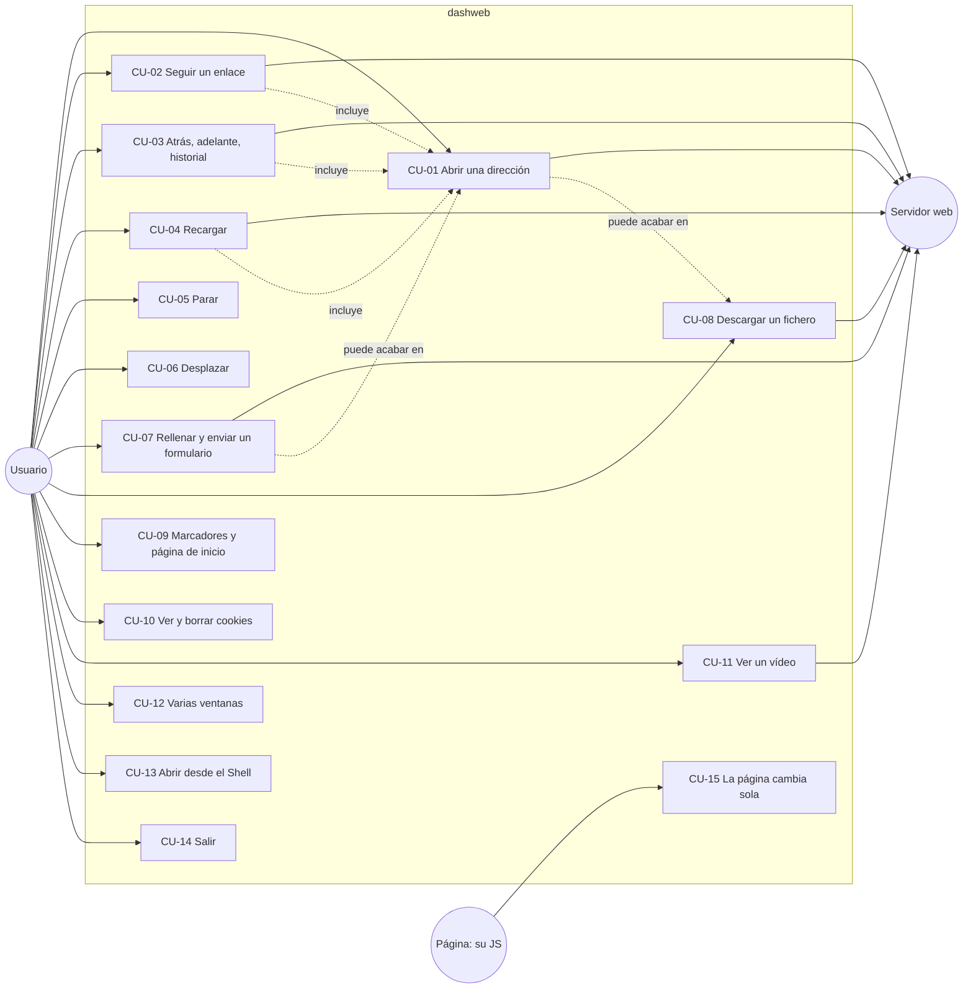

# 02. Casos de uso

Qué hace el usuario con dashweb y qué responde el sistema, paso a paso. Cada caso cita los requisitos de
[01](01_REQUISITOS.md); el detalle de cómo lo hace el código está en [03](03_FLUJOS.md) y [04](04_ESTADOS.md).

## Actores

| Actor | Quién es |
|---|---|
| Usuario | La persona delante del Amiga. |
| Servidor web | El que sirve páginas, hojas, scripts, imágenes y vídeos por HTTP o HTTPS. |
| Página | El JavaScript de la página abierta: cambia el DOM, pone temporizadores, envía formularios. |
| Sistema | AmigaOS, MUI, la pila TCP/IP y AmiSSL. |

## Mapa

## CU-01 Abrir una dirección

- **Actor:** Usuario. **Requisitos:** RF-01, RF-02, RF-03, RF-20, RF-21, RF-30 a RF-35, RF-40 a RF-53, RF-61.
- **Precondición:** dashweb abierto con al menos una ventana.
- **Flujo principal:**
  1. El usuario escribe una dirección en el campo de dirección y pulsa Return.
  2. El sistema completa la dirección (sin esquema ni `:`, antepone `http://`) y la apunta en el historial.
  3. Si es `http(s)`, empieza la carga sin bloquear: cambia "Recargar" por "Parar", muestra la barra de progreso y el
     indicador de actividad, y va diciendo en la barra de estado "Buscando", "Conectando", "Conexión segura",
     "Recibiendo N KB".
  4. Llega la respuesta. El sistema la pasa a Latin-1, construye el árbol y pide las hojas de estilo y los scripts.
     Estado: "Trayendo hojas de estilo y scripts: faltan N".
  5. Llegan todos. El sistema ejecuta los scripts, calcula el estilo, maqueta y pinta. Estado: "Listo: N bytes en M ms".
     El título de la ventana pasa a ser el de la página.
  6. Las imágenes y fuentes siguen llegando; la página se repinta al recibirlas. Estado: "Imágenes: faltan N" y,
     al acabar, "Listo".
- **Alternativas:**
  - 1a. Dirección vacía: se abre la página de inicio.
  - 2a. `dashweb:...` o `file:`: se abre en el momento, sin carga por la red.
  - 2b. Mismo documento con `#ancla`: solo se desplaza (CU-06).
  - 4a. La respuesta es un adjunto o un tipo que no se muestra: pasa a CU-08.
  - 4b. La respuesta es una imagen, un vídeo o texto plano: se muestra en una página propia.
  - 4c. Redirección: se sigue (hasta 5) sin intervención.
- **Errores:**
  - E1. No se encuentra el nombre, no se conecta, TLS falla o se agota el tiempo (20 s sin recibir nada): la barra de
    estado dice "Error: ..." y la ventana queda usable.
  - E2. Un script de la página falla: se escribe en la salida y la página se muestra igual.
- **Postcondición:** la página nueva es la actual de la ventana y la anterior se ha liberado.

## CU-02 Seguir un enlace

- **Actor:** Usuario (y Página). **Requisitos:** RF-10, RF-63.
- **Flujo principal:**
  1. El usuario hace clic sobre la página.
  2. El sistema busca el elemento bajo el ratón.
  3. Si la página tiene JS, le entrega el evento `click`. Si un manejador llama a `preventDefault()` o devuelve
     `false`, el caso acaba aquí (el JS puede haber cambiado la página: CU-15).
  4. Si el elemento está dentro de un enlace, se resuelve su destino contra la dirección de la página y se sigue
     CU-01 desde el paso 2.
- **Alternativas:** 3a. Es un `<video>`: CU-11. 3b. Es un control de formulario: CU-07. 4a. El enlace es
  `javascript:`: no se navega.

## CU-03 Atrás, adelante, historial

- **Actor:** Usuario. **Requisitos:** RF-04.
- **Flujo principal:**
  1. El usuario pulsa "Atrás" (o "Adelante"), o hace doble clic en una entrada de la lista del historial.
  2. El sistema mueve la posición en el historial y abre esa dirección (CU-01, sin apuntarla otra vez).
  3. Los iconos de atrás y adelante se encienden o se apagan según quede algo detrás o delante.
- **Alternativas:** 1a. El botón está apagado: no pasa nada. 1b. El usuario pulsa el botón del historial: la lista se
  muestra u oculta junto a la página.
- **Nota:** el historial es por ventana y no se guarda entre sesiones. Navegar desde una entrada intermedia descarta
  las de delante.

## CU-04 Recargar

- **Actor:** Usuario. **Requisitos:** RF-05.
- **Flujo:** el usuario pulsa "Recargar"; el sistema vuelve a abrir la entrada del historial que se ve (CU-01, sin
  apuntarla). Sin entrada, la página de inicio.

## CU-05 Parar

- **Actor:** Usuario. **Requisitos:** RF-06.
- **Precondición:** hay una carga o una preparación en curso (se ve "Parar").
- **Flujo:** el usuario pulsa "Parar"; el sistema cancela la carga, libera la página a medio preparar, vuelve a
  mostrar "Recargar", pone el progreso a 0 y el estado "Parado". La página anterior sigue a la vista.

## CU-06 Desplazar

- **Actor:** Usuario. **Requisitos:** RF-11.
- **Flujo:** el usuario mueve la barra, gira la rueda o pulsa flechas, espacio o retroceso con el ratón sobre la
  página; el sistema pinta desde la nueva posición. Las imágenes perezosas que quedan cerca empiezan a bajarse.
- **Alternativa:** hay un campo de formulario con el foco: las teclas van al campo (CU-07).

## CU-07 Rellenar y enviar un formulario

- **Actor:** Usuario (y Página). **Requisitos:** RF-60, RF-63.
- **Flujo principal:**
  1. El usuario hace clic en un campo de texto: el campo toma el foco.
  2. Escribe: cada tecla cambia el valor (respeta `maxlength`; retroceso borra).
  3. Marca casillas o radios, o elige en un desplegable (cada clic pasa a la opción siguiente).
  4. Pulsa Return en un campo o hace clic en el botón de enviar.
  5. Si la página tiene JS, recibe `submit`; si lo para, el caso acaba.
  6. El sistema arma el envío: GET con los datos en la dirección, o POST `x-www-form-urlencoded`, y sigue CU-01.
- **Alternativa:** 5a. El JS llama a `form.submit()`: se envía ese formulario tras el evento que lo provocó.

## CU-08 Descargar un fichero

- **Actor:** Usuario. **Requisitos:** RF-36.
- **Disparo:** CU-01 recibe cabeceras de algo que no es una página (`Content-Disposition: attachment`, un tipo que no
  es texto, imagen ni vídeo, o una extensión como `.lha`, `.zip`, `.adf`).
- **Flujo principal:**
  1. El sistema corta la carga y abre el selector de ficheros para guardar, con el nombre propuesto.
  2. El usuario elige el sitio (si elige un cajón, se usa el nombre propuesto).
  3. El sistema pide otra vez el fichero, sin comprimir, y lo baja allí. Estado: "Bajando a ...: N KB".
  4. Al acabar: "Guardado en ... (N KB)". La página anterior no ha cambiado.
- **Alternativas:** 2a. El usuario cancela: "Descarga cancelada". 3a. Error o estado no 2xx: "No se pudo guardar ...".

## CU-09 Marcadores y página de inicio

- **Actor:** Usuario. **Requisitos:** RF-07, RF-08.
- **Flujos:**
  - "Añadir marcador" (Amiga+D): guarda la dirección y el título de la página actual, sin repetir. Estado
    "Marcador: título".
  - "Marcadores" (Amiga+B): abre `dashweb:marcadores`, una página con un enlace por marcador.
  - "Usar como página de inicio": guarda la dirección actual como inicio.
  - "Página de inicio" (Amiga+H o el botón de la casa): abre la guardada, o `dashweb:inicio`.

## CU-10 Ver y borrar cookies

- **Actor:** Usuario. **Requisitos:** RF-35, RF-03.
- **Flujo:** el usuario abre `dashweb:cookies` (desde la página de inicio); ve las guardadas por dominio con un enlace
  para borrar las de cada uno o todas; al seguirlo, el sistema las borra, guarda el fichero y vuelve a mostrar la lista.

## CU-11 Ver un vídeo

- **Actor:** Usuario. **Requisitos:** RF-70 a RF-73.
- **Flujo principal:**
  1. El usuario hace clic sobre un `<video>` (se ve su cartel).
  2. El sistema empieza a bajarlo a `T:`. Si es de YouTube, antes resuelve la dirección del MP4.
  3. En cuanto se puede abrir con lo bajado, empieza a sonar y a verse; el sonido marca el ritmo.
  4. Otro clic lo para; otro, sigue. Al acabar, un clic vuelve a empezar.
  5. Clic en la esquina del vídeo: pantalla completa; espacio para o sigue; Esc o clic vuelve.
- **Errores:** formato no admitido, descarga rota o YouTube sin MP4: el vídeo queda en error y la barra de estado lo dice.

## CU-12 Varias ventanas

- **Actor:** Usuario. **Requisitos:** RF-09.
- **Flujo:** "Nueva ventana" (Amiga+N) abre otra con la página de inicio, desplazada de la anterior; "Cerrar
  ventana" (Amiga+K) o su botón de cierre la cierran y liberan su página. Cada ventana tiene su historial y su carga.
- **Alternativa:** ya hay 4: estado "Como mucho 4 ventanas".

## CU-13 Abrir desde el Shell

- **Actor:** Usuario. **Requisitos:** RF-12.
- **Flujo:** `dashweb http://a.org/ http://b.org/` abre una ventana por dirección. Sin direcciones, una con la página
  de inicio. `TRAZA` escribe la línea de tiempo de cada carga; `GCSIEMPRE` fuerza el GC de JS (para cazar fallos).

## CU-14 Salir

- **Actor:** Usuario.
- **Flujo:** "Salir" (Amiga+Q), o cerrar la última ventana. El sistema para las cargas, libera las páginas, cierra las
  conexiones libres, guarda las cookies persistentes y cierra MUI.

## CU-15 La página cambia sola

- **Actor:** Página (su JS). **Requisitos:** RF-63, RF-64.
- **Flujo:**
  1. Vence un temporizador de la página (o el usuario hizo clic: CU-02).
  2. El sistema ejecuta lo que toque y las promesas pendientes.
  3. Si el DOM cambió, rehace el estilo de lo afectado, vuelve a maquetar y repinta.
  4. Si el JS llamó a `form.submit()`, sigue CU-07 desde el paso 6.
- **Limitación:** el JS no puede navegar con `location` (RF-67) ni pedir datos con `fetch` (RF-65).
