# 03. Flujos

Cómo trabaja dashweb por dentro: diagramas de flujo y de secuencia de los procesos principales. Los nombres son
funciones reales del código (ver [07](07_MODULOS_E_INTERFACES.md)). Los estados de cada objeto están en
[04](04_ESTADOS.md).

Índice:

| ID | Flujo | Tipo |
|---|---|---|
| F-01 | Arranque y salida | Flujo |
| F-02 | Bucle de eventos | Flujo |
| F-03 | El temporizador único (`programar`) | Flujo |
| F-04 | El tic de una ventana (`tic`) | Flujo |
| F-05 | Cargar una página | Secuencia |
| F-06 | Avanzar la carga (`avanzar_carga`) | Flujo |
| F-07 | Montar la página (`documento_avanzar`, `mostrar`) | Flujo |
| F-08 | Pintar (`pinta_en`, `pintar`) | Flujo |
| F-09 | Un clic en la página (`clic`) | Flujo |
| F-10 | El JS cambia el DOM (`documento_al_dia`) | Flujo |
| F-11 | Enviar un formulario | Secuencia |
| F-12 | Descargar a disco | Secuencia |
| F-13 | Una imagen, de la red a la pantalla | Secuencia |
| F-14 | Una petición HTTP por dentro (`http_avanzar`) | Flujo |
| F-15 | Un vídeo | Secuencia |

## F-01 Arranque y salida

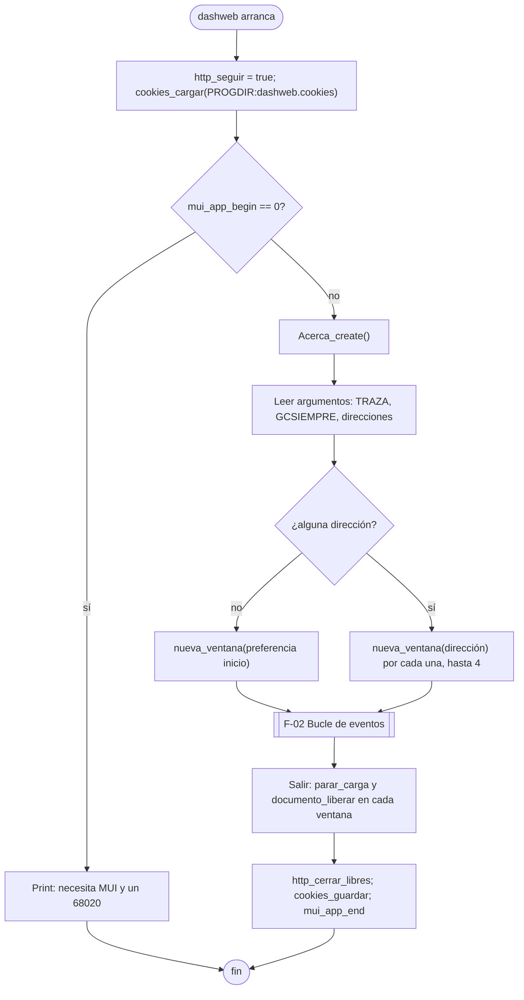

`nueva_ventana` crea la ventana con `Navegador_create()`, registra el dibujo (`pintaK`, `giroK`), la entrada del lienzo,
el doble búfer y el cierre (`ID_CERRADA + k`), la abre, la desplaza si no es la primera y abre su dirección.

## F-02 Bucle de eventos

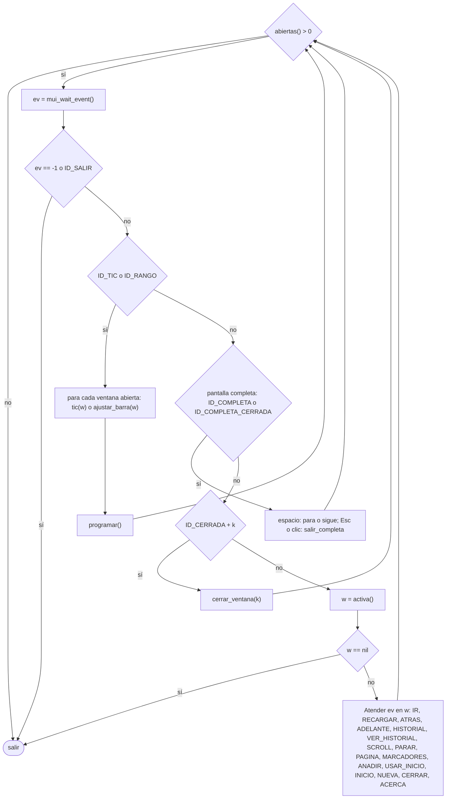

Los números de evento y lo que hace cada uno están en [06](06_INTERFAZ_DE_USUARIO.md).

## F-03 El temporizador único (`programar`)

Un solo `mui_timer` sirve a todas las ventanas. Se vuelve a calcular tras cada tic y cada vez que empieza algo.

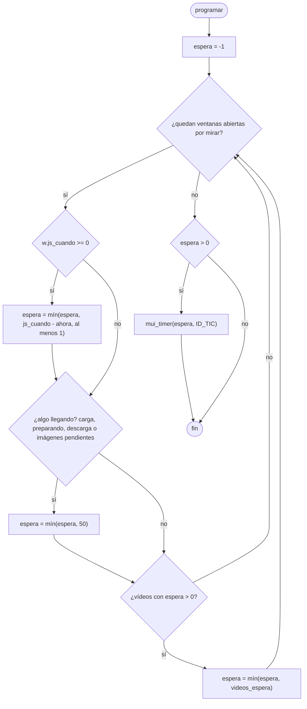

Sin nada pendiente no se arma el temporizador y el programa duerme en `mui_wait_event`. La red todavía no despierta
al programa por señal (tarea 39; ver [10](10_RIESGOS_Y_PENDIENTES.md)).

## F-04 El tic de una ventana (`tic`)

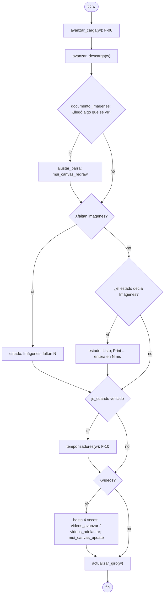

## F-05 Cargar una página

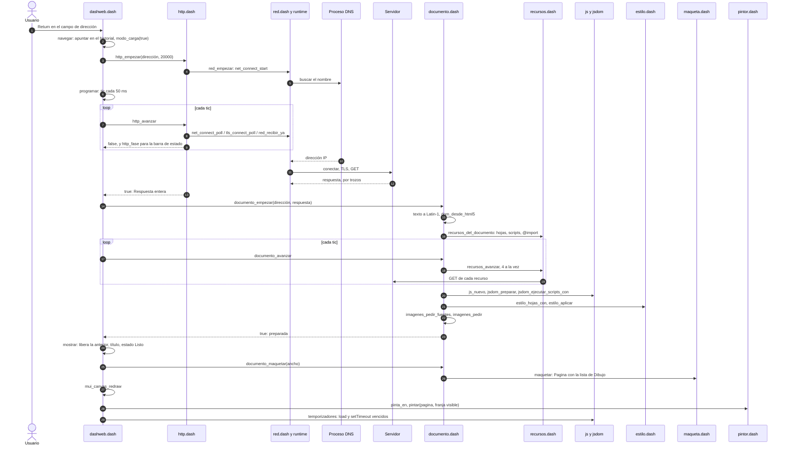

## F-06 Avanzar la carga (`avanzar_carga`)

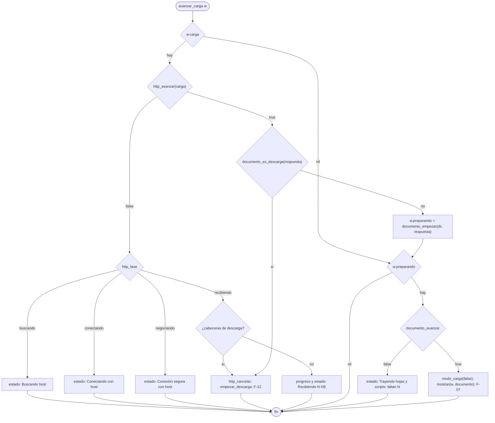

## F-07 Montar la página

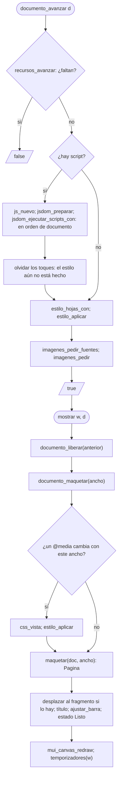

## F-08 Pintar

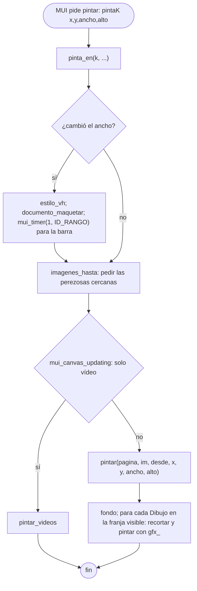

## F-09 Un clic en la página (`clic`)

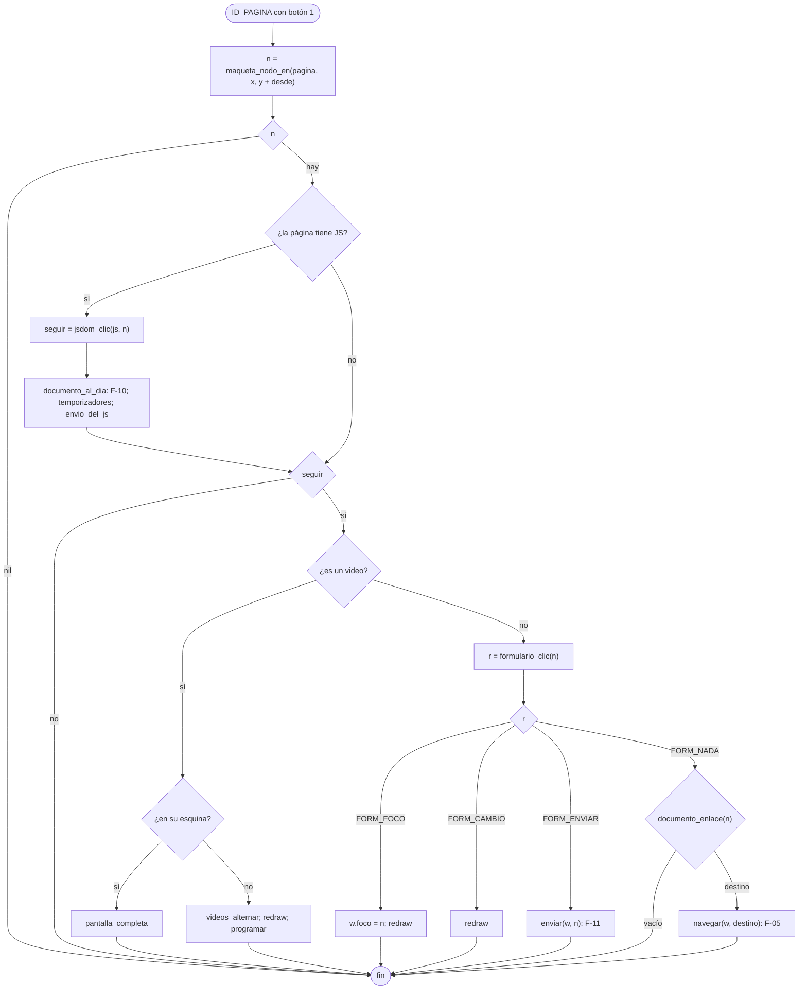

## F-10 El JS cambia el DOM (`documento_al_dia`)

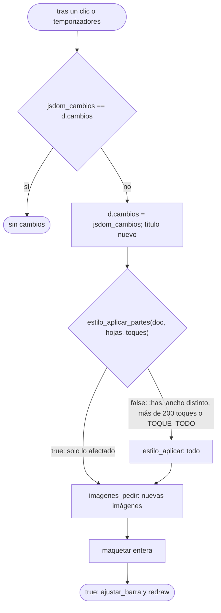

Qué recalcula `estilo_aplicar_partes` según el toque:

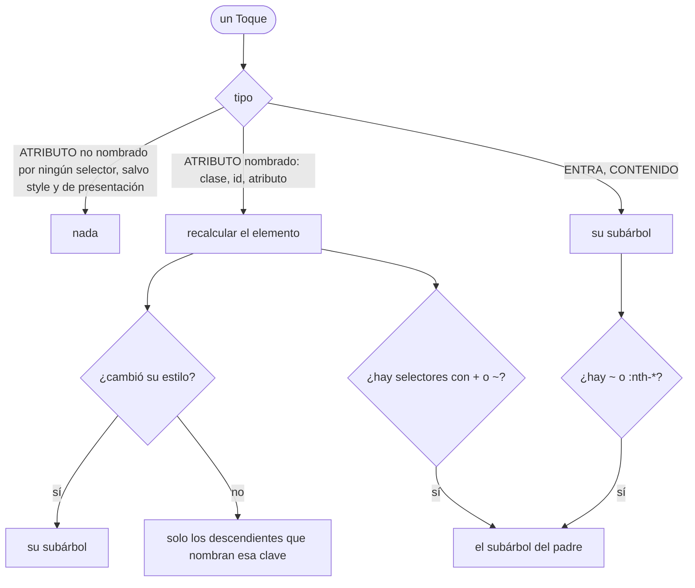

## F-11 Enviar un formulario

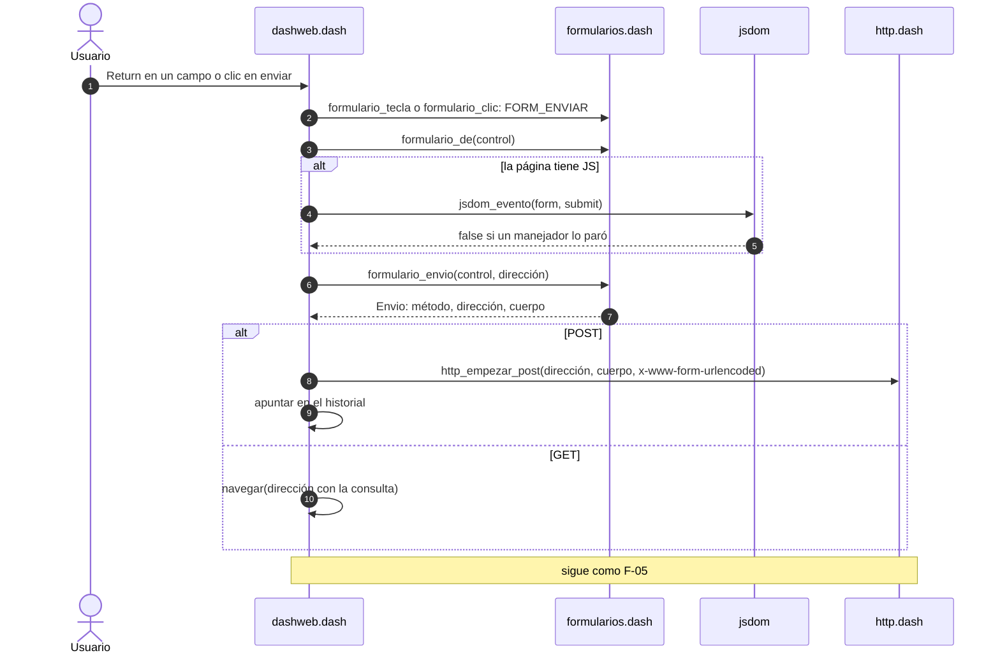

## F-12 Descargar a disco

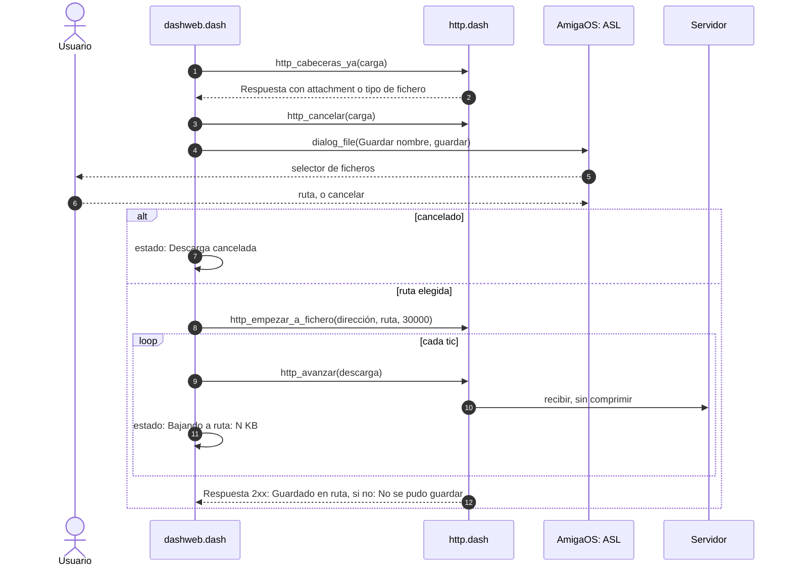

Nota: hoy la respuesta entera se guarda en memoria antes de escribirse al fichero (riesgo R-02 en
[10](10_RIESGOS_Y_PENDIENTES.md)).

## F-13 Una imagen, de la red a la pantalla

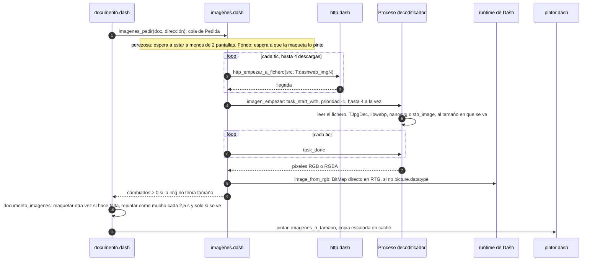

Si no se puede crear el proceso, se decodifica en el principal. Si los decodificadores propios no pueden, se usa
`image_load` (datatypes).

## F-14 Una petición HTTP por dentro (`http_avanzar`)

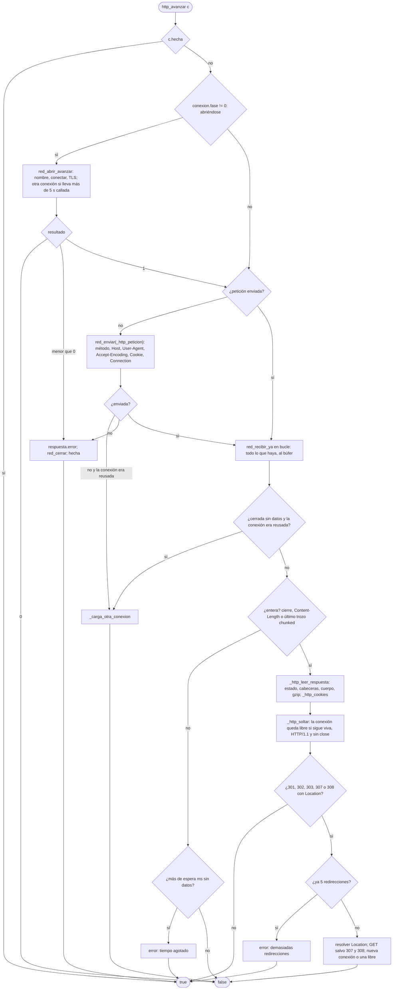

## F-15 Un vídeo

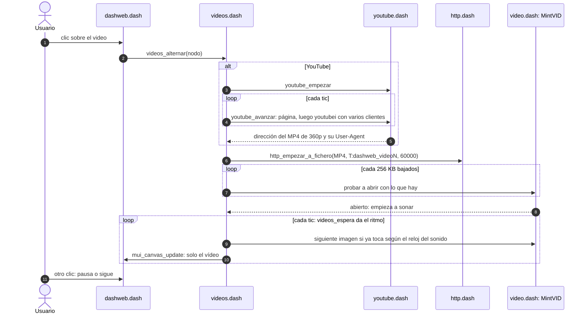
