# 04. Diagramas de estado

Los objetos de dashweb que cambian de estado con el tiempo, y qué los hace cambiar. Los flujos que los mueven están en
[03](03_FLUJOS.md); sus campos, en [05](05_MODELO_DE_DATOS.md).

| ID | Objeto | Dónde vive el estado |
|---|---|---|
| E-01 | La ventana del navegador | `struct Ventana` (`carga`, `preparando`, `actual`, `descarga`) |
| E-02 | Una carga HTTP | `struct Carga` + `Conexion.fase` |
| E-03 | Una conexión | `struct Conexion` y la lista de libres de `http.dash` |
| E-04 | Una página (`Documento`) | `struct Documento` |
| E-05 | Una imagen pedida | `struct Pedida` |
| E-06 | Un reproductor de vídeo | `Reproductor.estado` (`V_*`) |
| E-07 | La búsqueda de un vídeo de YouTube | `YouTube.paso` |
| E-08 | La barra de herramientas | `Ventana.cargando`, `con_atras`, `con_adelante`, `con_historial` |
| E-09 | El foco de los formularios | `Ventana.foco` |
| E-10 | La pantalla completa | `dw_completa` |

## E-01 La ventana del navegador

Una ventana puede tener a la vez una página a la vista (`actual`), otra llegando (`carga`, luego `preparando`) y una
descarga a disco (`descarga`). El diagrama sigue la página; la descarga va en paralelo.

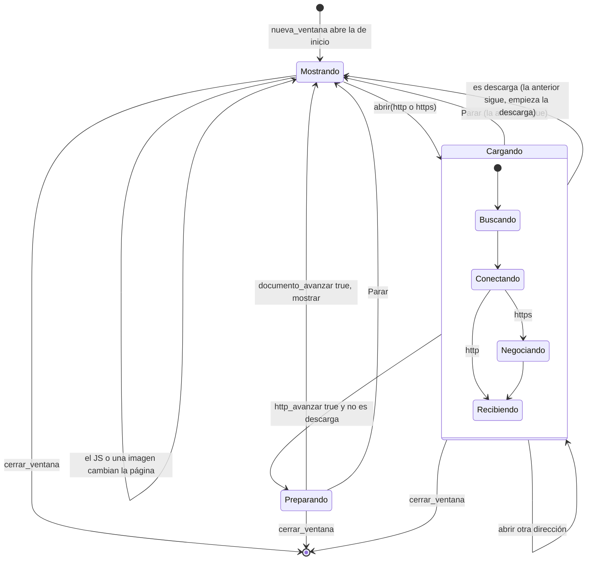

La descarga a disco:

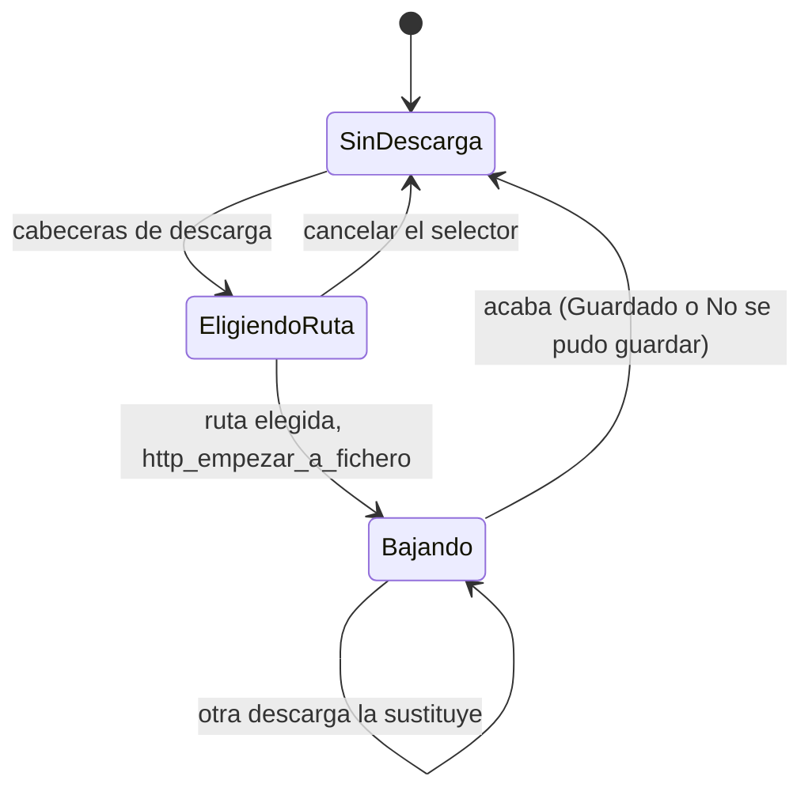

## E-02 Una carga HTTP (`Carga`)

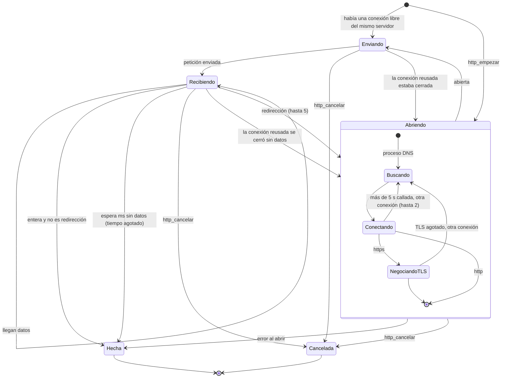

`http_fase` traduce el estado a lo que ve el usuario: `buscando`, `conectando`, `negociando`, `recibiendo` o `""` (hecha).

## E-03 Una conexión (`Conexion`)

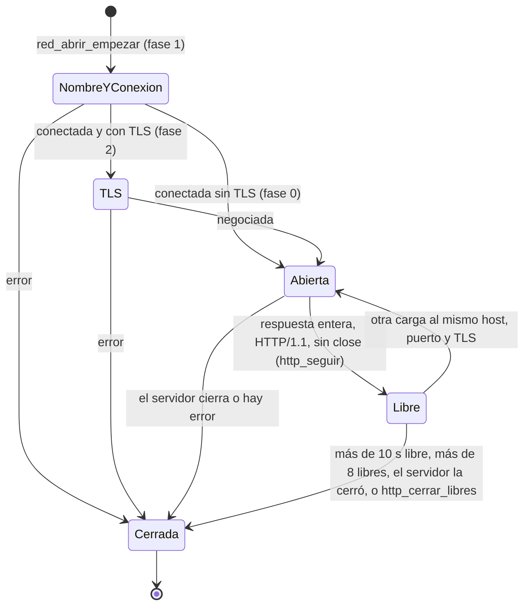

## E-04 Una página (`Documento`)

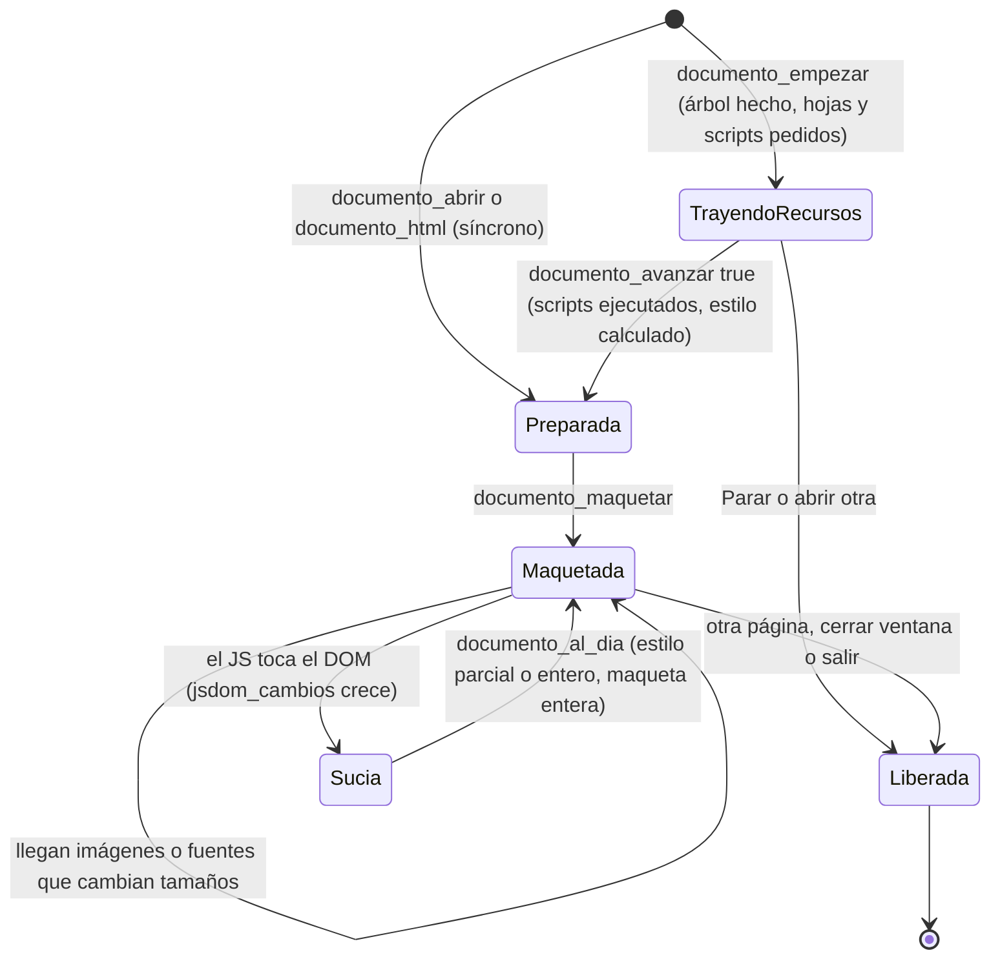

`documento_liberar` suelta recursos, imágenes (y sus ficheros de `T:`), vídeos y el motor JS. El árbol y la maqueta se
liberan al soltar la última referencia (el contador de Dash; `padre` es `weak`).

## E-05 Una imagen pedida (`Pedida`)

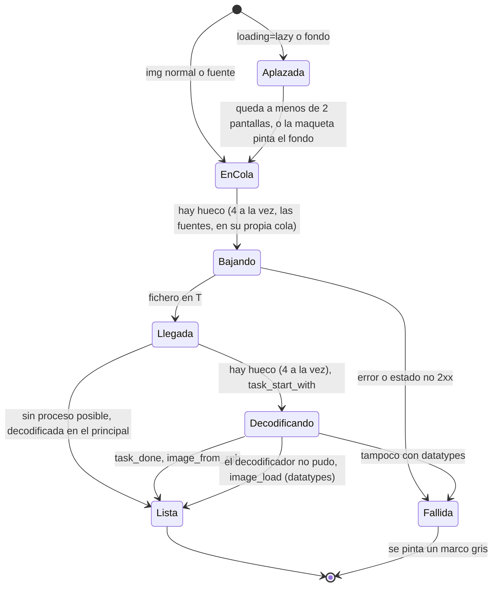

Una fuente web llega igual y en vez de decodificarse se registra (`fuente_web_registrar`), lo que obliga a maquetar
otra vez.

## E-06 Un reproductor de vídeo (`Reproductor.estado`)

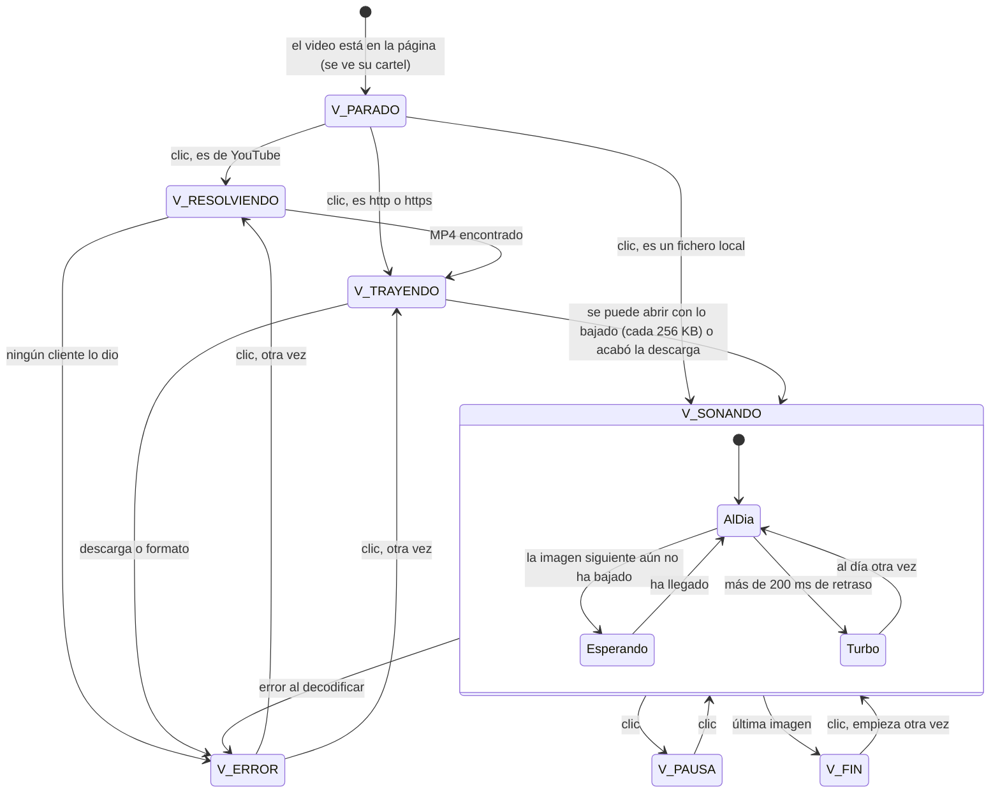

## E-07 La búsqueda de un vídeo de YouTube (`YouTube.paso`)

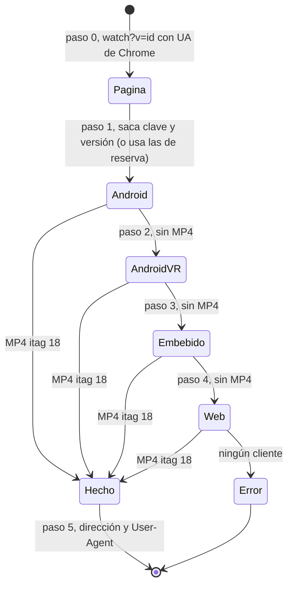

## E-08 La barra de herramientas

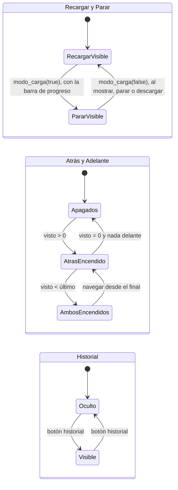

Los botones apagados no se desactivan en MUI (saldrían con una trama): cambian de icono (`*_apagado.iff`) y, pulsados,
no hacen nada.

## E-09 El foco de los formularios

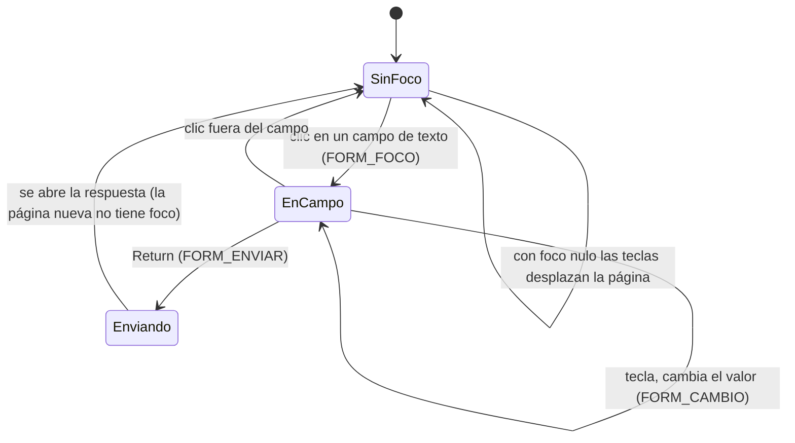

## E-10 La pantalla completa

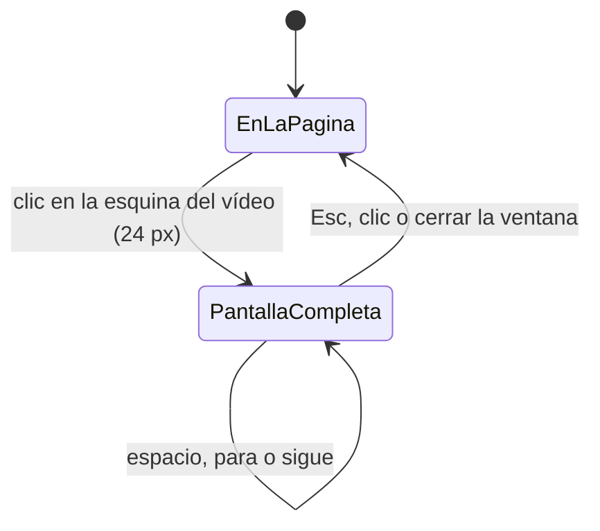
