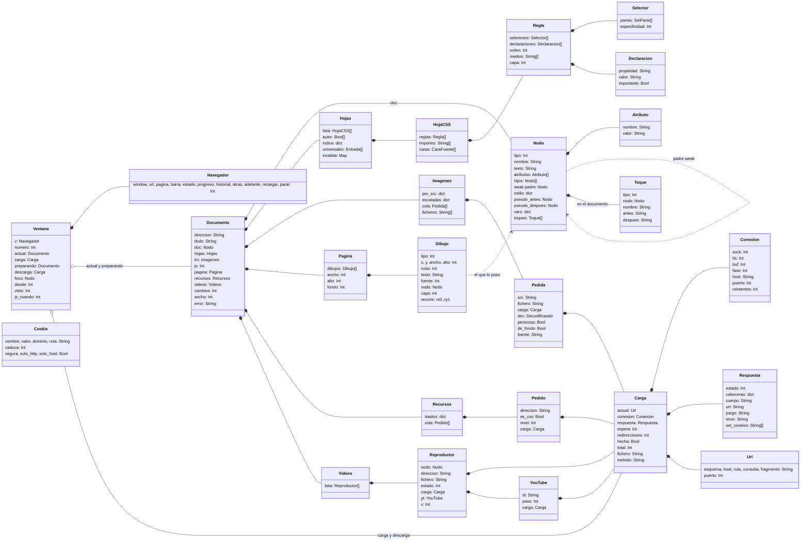

# 05. Modelo de datos

Las estructuras principales, cómo se relacionan, quién es dueño de cada una y los ficheros que el navegador lee y
escribe. La lista completa de structs con todos sus campos está en [07](07_MODULOS_E_INTERFACES.md).

## 1. Reglas generales de memoria

- Dash cuenta referencias: un struct, una lista o un texto se liberan cuando nadie los usa. Los ciclos no se liberan
  hasta salir; por eso los enlaces hacia arriba son `weak`.
- Lo que viene de C (imágenes, fuentes, el motor JS, búferes, sockets) es un `Int` (un puntero o un número) y se
  libera a mano con su función (`image_free`, `js_liberar`, `buffer_free`, `net_close`...).
- **Una página = un `Documento`**, dueño de todo lo suyo. Al cambiar de página se libera entero con
  `documento_liberar`.
- Prueba de que se cumple: `--memcheck` (0 objetos vivos al salir).

## 2. Diagrama de clases

`Cookie` vive aparte, en la lista global `cookies_todas` de `cookies.dash`: es de todo el programa, no de una página.

## 3. Estructuras clave

### `Nodo` (DOM)

- `tipo`: 1 elemento, 3 texto, 8 comentario, 9 documento, 11 fragmento.
- `nombre`: la etiqueta en minúsculas ("" en texto). `texto`: el contenido de un nodo de texto, en Latin-1.
- `estilo`: el **estilo calculado** del elemento, un diccionario propiedad → valor (texto). Solo `font-size` se guarda
  resuelto en px.
- `pseudo_antes`, `pseudo_despues`: los `::before` y `::after`, nodos con `padre` apuntando al elemento pero fuera de
  `hijos`.
- `vars`: las variables CSS (`--x`) que heredan sus hijos; se comparten con el padre mientras no cambian.
- `clases_cache`, `id_cache`: el atributo `class` partido y el `id`, guardados la primera vez.
- `toques`: solo en el nodo documento. Los cambios hechos por el JS desde la última maqueta (como mucho 200).

### `Dibujo` (lista de dibujo)

La maqueta no produce un árbol de cajas sino una **lista plana** en coordenadas de página. Tipos `D_*` (`maqueta.dash`):
`D_RECT` (rectángulo), `D_TEXTO`, `D_LINEA`, `D_IMAGEN`, `D_CONTROL` (control de formulario), `D_FONDO` (imagen de
fondo), `D_ICONO` (icono de una fuente de iconos), `D_ELIPSE`, `D_TRAZO` (barra girada 45°), `D_DEGRADADO`, `D_VIDEO`,
`D_REDONDO` (esquinas redondeadas). Cada dibujo
sabe de qué nodo sale (para los clics: `maqueta_nodo_en` recorre la lista hacia atrás), su capa (`z-index`) y su recorte
(`overflow`).

### `Carga` y `Respuesta`

- `Carga.total`: tamaño esperado; -1 todavía no se sabe, -2 hasta el cierre, -3 `chunked`.
- `Carga.espera`: ms sin recibir nada antes de dar la carga por perdida.
- `Carga.fichero`: si no está vacío, el cuerpo de una respuesta 2xx va a ese fichero.
- `Respuesta.cabeceras`: nombres en minúsculas; las repetidas, juntas con ", ". Las `Set-Cookie` van aparte en
  `set_cookies`.
- `Respuesta.cuerpo`: texto; `http_texto` lo pasa a Latin-1 según `juego`.

### `Ventana` (solo en `src/dashweb.dash`)

Envuelve el struct generado del `.dashui` (`v: Navegador`) y guarda el estado de la ventana: la página a la vista, la
que llega, la descarga, el historial (`visto`: la entrada que se ve; la lista vive en el objeto MUI `v.historial`), el
desplazamiento (`desde`), el foco del formulario, la hora del siguiente temporizador del JS (`js_cuando`) y el estado
de los botones.

## 4. Dueños y vida de cada cosa

| Qué | Dueño | Se crea | Se libera |
|---|---|---|---|
| `Documento` y todo lo suyo | `Ventana.actual` o `.preparando` | `documento_empezar` / `documento_abrir` | `documento_liberar` al mostrar otra, parar, cerrar ventana o salir |
| Motor JS (`Documento.js`) | el `Documento` | `js_nuevo`, si hay `<script>` | `js_liberar` dentro de `documento_liberar` |
| Objetos JS de nodos | el motor JS | al tocar un nodo desde JS | al liberar el motor (retienen su `Nodo` hasta entonces) |
| Imágenes (`por_src`, `escaladas`) | `Documento.im` | al decodificar | `imagenes_liberar`, que también borra sus ficheros de `T:` |
| Ficheros de vídeo en `T:` | `Documento.videos` | al reproducir | al liberar el documento |
| Conexiones libres | `http.dash` (global) | al acabar una respuesta reutilizable | a los 10 s, al pasar de 8, o `http_cerrar_libres` al salir |
| Sesiones TLS | runtime de Dash | primera conexión a un servidor | al salir (8 como mucho) |
| Cookies | `cookies.dash` (global) | `Set-Cookie` o `document.cookie` | al caducar, al borrarlas, o al pasar de 300 (la más antigua) |
| Fuentes abiertas del Amiga | `maqueta.dash` (global) | primera vez que se usan | al salir |
| Fuentes web rasterizadas | `fuente_web.dash` (global) | al llegar un `@font-face` | al salir (no al cambiar de página) |
| Hoja del navegador y selectores leídos | `estilo.dash` (global) | primera página | al salir |

## 5. Ficheros que lee y escribe

Todos en Latin-1, una entrada por línea.

| Fichero | Contenido | Formato | Módulo |
|---|---|---|---|
| `PROGDIR:dashweb.marcadores` | Marcadores | `dirección<TAB>título` | `marcadores.dash` |
| `PROGDIR:dashweb.prefs` | Preferencias (hoy solo `inicio`) | `clave=valor` | `marcadores.dash` |
| `PROGDIR:dashweb.cookies` | Cookies persistentes | `dominio<TAB>solo_host<TAB>ruta<TAB>segura<TAB>solo_http<TAB>caduca<TAB>nombre<TAB>valor`; los Bool como `true`/`false`; `caduca` en segundos desde 1970 | `cookies.dash` |
| `PROGDIR:iconos/*.iff` | Iconos de la barra (ILBM, 16x14, 4 colores) | Lectura | `navegador.dashui`, `src/dashweb.dash` |
| `T:dashweb_imgN`, `T:dashweb_svgN.svg` | Imágenes bajadas | Temporales | `imagenes.dash` |
| `T:dashweb_fuenteN` | Fuentes web bajadas | Temporales | `imagenes.dash` |
| `T:dashweb_videoN` | Vídeos bajados | Temporales | `videos.dash` |
| `FONTS:` | Fuentes del Workbench (helvetica, times, courier) y vectoriales | Lectura | `maqueta.dash` |
| `AmiSSL:Certs` | Certificados raíz | Lectura (AmiSSL) | runtime de Dash |

## 6. Juego de caracteres

- Dentro de dashweb todo texto es **Latin-1** (ISO-8859-1): el DOM, el CSS, lo que se pinta y los ficheros.
- Entrada: `texto_decodificar` pasa UTF-8 y Windows-1252 a Latin-1 con sustitutos (comillas tipográficas a rectas,
  guiones a `-`, `€` a `EUR`, el resto a `?`).
- JS: QuickJS trabaja en UTF-8. Cada texto que cruza entre JS y DOM se convierte; lo que no es Latin-1 llega como `?`.
- Salida: las direcciones se codifican como UTF-8 con `%XX` (`url_codificar`).
