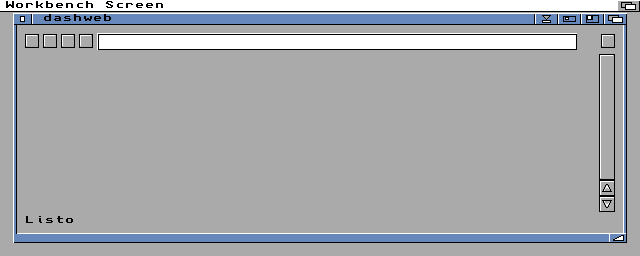

# 06. Interfaz de usuario

La ventana, sus objetos, menús, atajos, eventos y mensajes. La ventana está definida en `src/navegador.dashui`
(editor visual de MUI, ver `docs/COMO_SE_CONSTRUYE.md`) y su comportamiento en `src/dashweb.dash`.



## 1. Ventana principal (`Navegador`)

Título: "dashweb", o "Título de la página - dashweb". Se abre al 96 % del ancho y el 90 % del alto de la pantalla. MUI
recuerda su sitio (id 1). Hasta 4 a la vez; cada una nueva sale desplazada 24x16 píxeles.

```
┌ dashweb ─────────────────────────────────────────────────────────────────────┐
│ [◄][►][⟳|■][⌂] [ dirección ......................................... ] • [≡]│  barra de herramientas
├──────────────┬┬──────────────────────────────────────────────────────────┬──┤
│ historial    ││                                                          │▲ │
│ (oculto)     ││                    página (lienzo)                       │█ │  contenido
│              ││                                                          │▼ │
├──────────────┴┴──────────────────────────────────────────────────────────┴──┤
│ estado                                              [progreso (oculto)]     │  barra de estado
└─────────────────────────────────────────────────────────────────────────────┘
```

### Objetos

| Nombre | Tipo MUI | Evento | Ayuda | Notas |
|---|---|---|---|---|
| `atras` | botón con imagen | 1 | Atrás | Icono `atras.iff` o `atras_apagado.iff` |
| `adelante` | botón con imagen | 2 | Adelante | Icono `adelante.iff` o `adelante_apagado.iff` |
| `recargar` | botón con imagen | 3 | Recargar la página | Oculto mientras carga |
| `parar` | botón con imagen | 13 | Parar la carga | Visible solo mientras carga |
| `inicio` | botón con imagen | 17 | Página de inicio | |
| `url` | campo de texto (1024) | 4 al pulsar Return | Dirección: escríbela y pulsa Return | Peso 400 |
| `actividad` | lienzo 16x16 | — | — | Un punto mientras algo llega |
| `ver_historial` | botón con imagen | 20 | Historial (mostrar u ocultar) | |
| `historial` | lista | 6 con doble clic | — | Oculta al empezar; peso 25 |
| `separador` | separador arrastrable | — | — | Visible con el historial |
| `pagina` | lienzo (mín. 500x100) | 10 (ratón, rueda, teclas) | — | Doble búfer |
| `barra` | barra de desplazamiento vertical | 5 al cambiar | — | Rango: alto de la página y alto visible |
| `estado` | texto | — | — | Como mucho 48 caracteres (si no, "...") |
| `progreso` | barra de progreso (0-100) | — | — | Visible solo mientras carga; peso 30 |

### Menú "Proyecto"

| Opción | Atajo | Evento | Qué hace |
|---|---|---|---|
| Nueva ventana | Amiga+N | 18 | Abre otra ventana con la página de inicio (máx. 4) |
| Cerrar ventana | Amiga+K | 19 | Cierra la ventana activa |
| — | | | |
| Página de inicio | Amiga+H | 17 | Abre la página de inicio |
| Marcadores | Amiga+B | 14 | Abre `dashweb:marcadores` |
| Añadir marcador | Amiga+D | 15 | Guarda la página actual en los marcadores |
| Usar como página de inicio | — | 16 | Guarda la dirección actual como inicio |
| — | | | |
| Acerca de... | Amiga+? | 8 | Abre o cierra la ventana "Acerca de" |
| — | | | |
| Salir | Amiga+Q | 9 | Cierra el programa |

### Eventos del programa (no están en el `.dashui`)

| Constante | Valor | Origen | Qué hace |
|---|---|---|---|
| `ID_TIC` | 11 | `mui_timer` | Avanza cargas, descargas, imágenes, temporizadores del JS y vídeos de cada ventana |
| `ID_RANGO` | 12 | `mui_timer(1)` desde el dibujo | Ajusta la barra después de maquetar con otro ancho |
| `ID_CERRADA + k` | 100-103 | botón de cierre de la ventana k | Cierra esa ventana |
| `ID_COMPLETA` | 90 | lienzo de pantalla completa | Espacio: para o sigue; Esc o clic: salir |
| `ID_COMPLETA_CERRADA` | 91 | cierre de la pantalla completa | Vuelve a la página |

## 2. Ratón y teclado sobre la página

Con el ratón sobre el lienzo (`pagina`):

| Entrada | Sin foco en un campo | Con foco en un campo de texto |
|---|---|---|
| Clic izquierdo | Enlace, control de formulario, vídeo o manejador JS (ver [03](03_FLUJOS.md), F-09) | Igual; un clic fuera quita el foco |
| Rueda | Desplaza 30 px por paso | Desplaza 30 px por paso |
| Flecha abajo / arriba | Desplaza 20 px | La recibe el campo |
| Espacio | Una pantalla abajo (menos 20 px) | Escribe un espacio |
| Retroceso | Una pantalla arriba | Borra la última letra |
| Return | — | Envía el formulario |
| Otra tecla | — | Escribe el carácter (según el mapa de teclado) |

## 3. Mensajes de la barra de estado

| Momento | Mensaje |
|---|---|
| Empieza una carga | Conectando con *dirección*... |
| Buscando el nombre | Buscando *host*... |
| Conectando | Conectando con *host*... |
| Negociando TLS | Conexión segura con *host*... |
| Recibiendo | Recibiendo *dirección*: *N* KB |
| Llegó la página | Trayendo hojas de estilo y scripts... / ...: faltan *N* |
| Mostrada | Listo: *N* bytes en *M* ms |
| Faltan imágenes | Imágenes: faltan *N* |
| Todo llegado | Listo |
| Error | Error: *mensaje* |
| Parar | Parado |
| Página local o interna | Abriendo *dirección*... |
| POST | Enviando a *dirección*... |
| Descarga | Bajando *nombre* a *ruta*... / Bajando a *ruta*: *N* KB / Guardado en *ruta* (*N* KB) / No se pudo guardar *ruta*: *error* *estado* / Descarga cancelada: *nombre* |
| Marcador | Marcador: *título* / No se pudo guardar el marcador |
| Inicio | Página de inicio: *dirección* |
| Ventanas | Como mucho 4 ventanas |
| Vídeo | El estado del vídeo, como mucho una vez por segundo |

## 4. Páginas internas

| Dirección | Contenido |
|---|---|
| `dashweb:inicio` (o dirección vacía) | Presentación, cómo escribir una dirección y enlaces a Marcadores y Cookies |
| `dashweb:marcadores` | Un enlace por marcador |
| `dashweb:cookies` | Las cookies guardadas por dominio, con enlaces para borrar las de un dominio o todas |
| `dashweb:cookies?borrar` / `?borrar=dominio` | Borra, guarda el fichero y muestra la lista |

## 5. Ventana "Acerca de" (`Acerca`)

Texto centrado ("dashweb / un navegador para Amiga hecho en Dash / QuickJS, AmiSSL y MUI") y un botón "Cerrar". Su
botón de cierre y el botón mandan el evento 8, que la abre o la cierra.

## 6. Pantalla completa (vídeo)

Una ventana MUI sin bordes del tamaño de la pantalla, con un lienzo negro y el vídeo con su proporción. Con MUI 3.8 queda
un marco gris de unos píxeles (el espaciado de ventana de sus preferencias).

## 7. Pautas de la interfaz

- Los botones que no llevan a ningún sitio cambian de icono en vez de desactivarse (MUI los taparía con una trama).
- Lo que no se usa se oculta (`mui_set_visible`): Parar, progreso, historial.
- Ningún texto de la ventana puede ensancharla: el estado se recorta.
- Los iconos son ILBM de 4 colores (los del Workbench): se ven igual en cualquier pantalla.
- La ventana nunca se bloquea: todo lo que tarda va por tics (ver [03](03_FLUJOS.md), F-02 a F-04).
- Abierto desde el icono no abre consola (`@workbench_output "NIL:"`).
