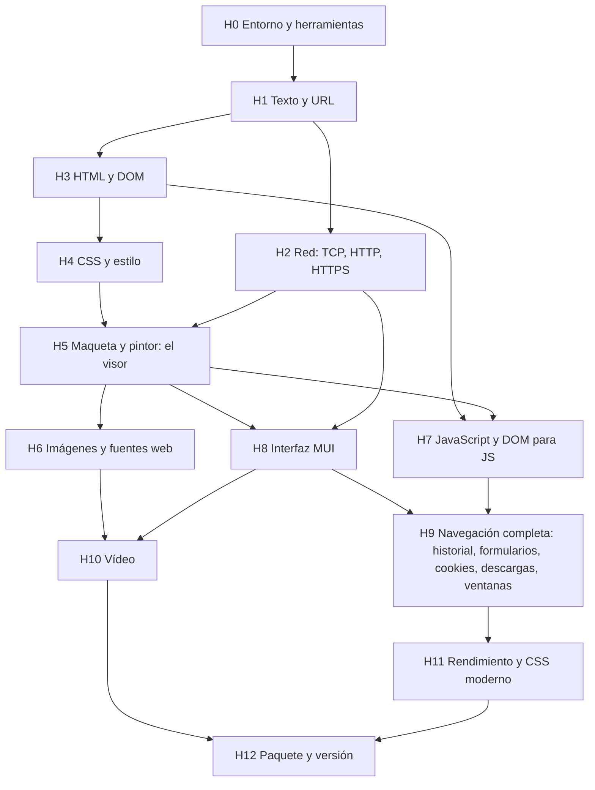

# 11. Plan de construcción

Cómo construiría dashweb un equipo que empieza de cero con esta documentación: hitos en orden de dependencia, qué se
entrega en cada uno, cómo se acepta y qué requisitos cubre. Es el orden en que se hizo (fase A sin MUI, fase B con MUI),
ordenado y sin los rodeos.

## 1. Dependencias entre hitos

H2 y H3 pueden ir en paralelo. H6, H7 y H8 también, una vez hecho H5.

## 2. Hitos

### H0 Entorno y herramientas

- **Entregables:** compilador cruzado, Dash, FS-UAE con los sistemas de [09](09_ENTORNO_CONSTRUCCION_Y_ENTREGA.md);
  `tests/run.py` (compila `tests/test_*.dash`, ejecuta en un arranque de FS-UAE y compara con `# expect-out:`); servidores
  de prueba en Python (`tests/servers/`).
- **Aceptación:** `test_hola` pasa en FS-UAE con la ROM 3.1 (no AROS).

### H1 Texto y URL

- **Módulos:** `texto.dash` (UTF-8 y Windows-1252 a Latin-1, sustitutos, entidades), `url.dash` (RFC 3986: analizar,
  resolver, escribir; `file:`).
- **Aceptación:** `test_texto`; `test_url` con todos los ejemplos del RFC 3986 §5.4.
- **Requisitos:** RF-41, RF-02, RNF-12.

### H2 Red

- **Módulos:** `red.dash` (conexión con búfer, líneas y trozos, sin bloquear), `http.dash` (HTTP/1.1 síncrono y por
  trozos: `Carga`, redirecciones, `chunked`, gzip, conexiones que se reutilizan), TLS con AmiSSL.
- **Aceptación:** `test_red`, `test_http`, `test_http_carga`, `test_http_gzip`, `test_http_seguir`, `test_https`.
- **Requisitos:** RF-30 a RF-34, RNF-05.
- **Nota:** el DNS siempre espera en AmigaOS: hace falta otro proceso (en Dash, `net_connect_start`).

### H3 HTML y DOM

- **Módulos:** `dom.dash` (`Nodo`, `padre` débil, búsquedas), `html5.dash` (Hubbub), `html.dash` (analizador propio, para
  `innerHTML` y de reserva).
- **Aceptación:** `test_html5`, `test_dom`, `test_html_tokens`; `--memcheck` sin nada vivo (el árbol se libera entero).
- **Requisitos:** RF-40.

### H4 CSS y estilo

- **Módulos:** `css.dash` (lectura, selectores, especificidad, `@media`, `@import`, `@layer`, `@supports`, `@font-face`,
  `@keyframes`), `colores.dash`, `estilo.dash` (índice de selectores, cascada, herencia, variables, `calc()`, estilo
  calculado en el nodo).
- **Aceptación:** `test_css`, `test_css_escapes`, `test_selectores4`, `test_estilo`, `test_estilo_calc`,
  `test_estilo_capas`, `test_estilo_vars`, `test_colores4`.
- **Requisitos:** RF-42, RF-43, RF-49.

### H5 Maqueta y pintor: el visor

- **Módulos:** `maqueta.dash` (bloques, líneas, flex, grid, tablas, posicionado, flotantes, capas → lista plana de
  `Dibujo`), `pintor.dash` (lista → `gfx_`), `documento.dash` (la página dueña de todo), `src/visor.dash` (una ventana de
  Intuition, sin MUI, que abre una página y la desplaza).
- **Aceptación:** `test_maqueta*`; el visor muestra `tests/pages/prueba.html` en el emulador (captura);
  `tools/comparar_chrome.py` sobre las webs de prueba.
- **Requisitos:** RF-44 a RF-48.
- **Hito de proyecto:** fin de la **fase A**: el motor entero sin interfaz MUI.

### H6 Imágenes y fuentes web

- **Módulos:** `imagenes.dash` (cola de descargas, tamaños, perezosas, fondos, caché de escaladas), `imagen_dec.dash`
  (TJpgDec, stb_image, libwebp, nanosvg en otro proceso), `fuente_web.dash` (stb_truetype → `TextFont`);
  `tools/build_img.sh`.
- **Aceptación:** `test_imagen_dec`, `test_imagenes`, `test_imagenes_carga`, `test_srcset`, `test_svg_pagina`,
  `test_fuente_web`.
- **Requisitos:** RF-51, RF-52.

### H7 JavaScript

- **Módulos:** QuickJS como librería (`tools/build_qjs.sh lib`, con fdlibm y los tres cambios de
  `docs/quickjs_amiga.md`), `js.dash` (motor por página, límites, promesas), `jsdom.dash` + `jsdom_preludio.js` (objeto JS
  por nodo, métodos, eventos, temporizadores), restyle parcial (`estilo_aplicar_partes`).
- **Aceptación:** `test_js`, `test_jsdom`, `test_jsdom_eventos`, `test_jsdom_texto`, `test_js_url`,
  `test_jsdom_interfaces`, `test_jquery`, `test_estilo_partes`.
- **Requisitos:** RF-61 a RF-64.

### H8 Interfaz MUI

- **Entregables:** `src/navegador.dashui` (ventana, menús, eventos: [06](06_INTERFAZ_DE_USUARIO.md)) y
  `src/dashweb.dash` con el bucle de eventos y el temporizador único ([03](03_FLUJOS.md), F-02 a F-04); lienzo con doble
  búfer; carga sin bloquear con fases en la barra de estado; Parar.
- **Aceptación:** PA-01 a PA-04 de [08](08_PLAN_DE_PRUEBAS.md); captura con `medir_visor.py --programa src/dashweb.dash`.
- **Requisitos:** RF-01, RF-05, RF-06, RF-11, RF-13, RF-20 a RF-24, RNF-05.
- **Hito de proyecto:** inicio de la **fase B**.

### H9 Navegación completa

- **Entregables:** historial por ventana, marcadores y página de inicio (`marcadores.dash`), formularios
  (`formularios.dash`, GET y POST), cookies (`cookies.dash`, persistentes), descargas a disco, documentos que no son HTML,
  varias ventanas, páginas `dashweb:`.
- **Aceptación:** `test_formularios`, `test_formularios_post`, `test_cookies`, `test_marcadores`, `test_navegacion`,
  `test_documento_tipo`; PA-05 a PA-13 y PA-15 a PA-17.
- **Requisitos:** RF-03, RF-04, RF-07 a RF-10, RF-12, RF-35, RF-36, RF-53, RF-60.

### H10 Vídeo

- **Entregables:** `tools/build_video.sh` (MintVID, MintAMP), `video.dash`, `videos.dash` (estados de
  [04](04_ESTADOS.md), E-06), `youtube.dash`, pantalla completa.
- **Aceptación:** `test_video`, `test_video_bajando`, `test_video_cartel`, `test_youtube`; PA-14.
- **Requisitos:** RF-70 a RF-73.

### H11 Rendimiento y CSS moderno

- **Trabajo:** medir con `--traza` y `--perfil` y quitar trabajo (índice de selectores, filtro de antecesores, caché de
  la cascada, repintar menos, imágenes perezosas, bloqueo de rastreadores, conexiones reutilizadas); CSS por módulos
  comparado con Chrome (Flexbox, Grid, Selectors 4, Color 4/5, Text 3, transformaciones, `@layer`).
- **Aceptación:** PR-01 a PR-06 de [08](08_PLAN_DE_PRUEBAS.md).
- **Requisitos:** RNF-06, RNF-11, RF-37.

### H12 Paquete y versión

- **Entregables:** `tools/paquete.sh`, iconos de Workbench, guion del Installer, `LEEME` en Latin-1, licencias.
- **Aceptación:** criterios del apartado 8 de [08](08_PLAN_DE_PRUEBAS.md).
- **Requisitos:** RNF-13, RNF-14.

## 3. Lo que el lenguaje tuvo que tener

Si el equipo usa Dash, lo que dashweb necesitó ya está (tareas D1-D61, ver `docs/ARQUITECTURA.md`, apartado 15). Si
construye el navegador con otro lenguaje, esto es lo que debe ofrecer el suyo o una librería:

| Necesidad | Para | En Dash |
|---|---|---|
| Textos rápidos (índice, trozos, concatenar sin coste cuadrático) | Analizadores | D2, D3, D17 |
| Listas y diccionarios con tipo | Todo | D4, D5 |
| Referencias débiles | El árbol DOM sin ciclos | D6 |
| TCP sin bloquear y DNS en otro proceso | Red | D8, D36 |
| TLS (AmiSSL) con reanudación | HTTPS | D11, D55 |
| Fuentes del Amiga, colores RGB a lápices, mezclas y degradados | Pintor | D9, D42, D51 |
| Imágenes desde RGB, escalado | Imágenes | D12, D43, D54 |
| Enlazar C de fuera y llamar a Dash desde C | QuickJS, Hubbub, decodificadores | D10, D10b |
| Procesos para C pesado | Decodificar sin parar la interfaz | D47 |
| MUI con zona de dibujo propia, temporizador, ventanas a pantalla completa | Interfaz | D31, D32, D48 y la rama `mui` |
| Señal de la red para despertar al programa | Cargas más rápidas | D60 |
| Perfilador y comprobación de memoria | Medir y cazar fallos | D23, `--memcheck` |
